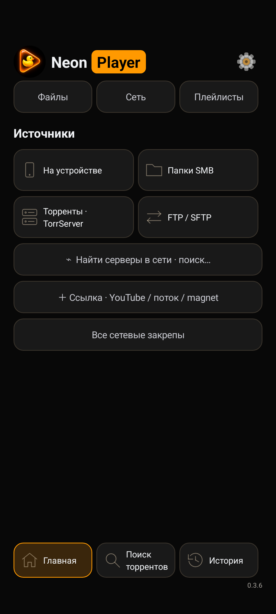
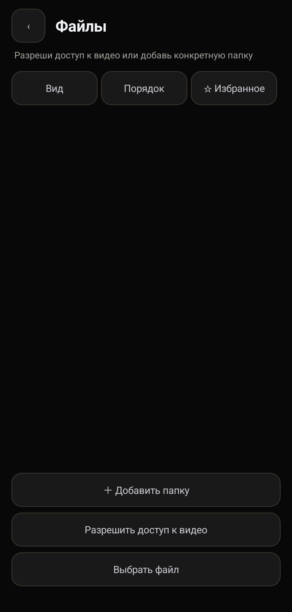
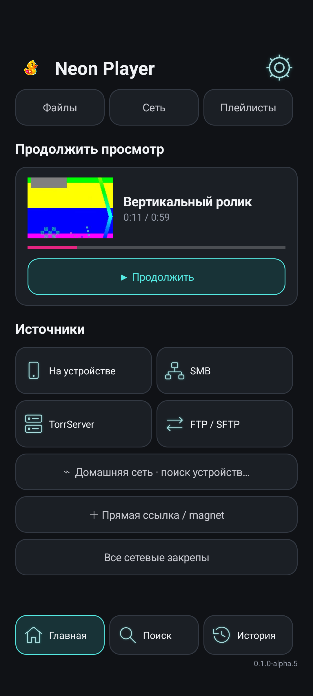

# Neon Player · Android

**Ваши файлы. Ваша сеть. Ваше воспроизведение.**

Полный плеер на **libmpv** для телефона, планшета и Android TV — и завершённая облегчённая версия **Lite** в одном репозитории.

[**Скачать 0.3.7**](https://github.com/jeronimo701/NeonPlayer-Android/releases/tag/v0.3.7) · [**Скачать Lite 0.6.0**](https://github.com/jeronimo701/NeonPlayer-Android/releases/download/v0.3.7/Neon-Lite-0.6.0-universal.apk) · [Windows-плеер](https://github.com/jeronimo701/mpv-neon)

## Выберите свою версию

| | **Neon Player · Full 0.3.7** | **Neon Lite · 0.6.0** |
|---|---|---|
| Движок | libmpv / FFmpeg | Системный MediaPlayer Android |
| Android | 8.0 и новее | 7.0 и новее |
| Для кого | Расширенные настройки, шейдеры, дорожки и сетевые источники | Базовый просмотр с меньшим комплектом зависимостей |
| Возможности | SMB, FTP/SFTP, TorrServer, YouTube, плейлисты и история | Локальные файлы, SMB, TorrServer и SBS; возможности декодеров зависят от устройства |
| Развитие | Основная версия проекта | **Завершена: дальнейшие обновления не планируются** |
| Установка | Отдельный APK для своей архитектуры | Один APK без native-декодера |

Full и Lite имеют разные package ID и могут стоять рядом. Настройки и история между ними не переносятся автоматически.

## Скачивание

| Ваше устройство | APK |
|---|---|
| Большинство современных телефонов, планшетов и ТВ | [**Full · arm64-v8a**](https://github.com/jeronimo701/NeonPlayer-Android/releases/download/v0.3.7/Neon-Player-0.3.7-arm64-v8a.apk) |
| 32-битные ARM-устройства с Android 8+ | [**Full · armeabi-v7a**](https://github.com/jeronimo701/NeonPlayer-Android/releases/download/v0.3.7/Neon-Player-0.3.7-armeabi-v7a.apk) |
| Android на x86_64 / совместимый эмулятор | [**Full · x86_64**](https://github.com/jeronimo701/NeonPlayer-Android/releases/download/v0.3.7/Neon-Player-0.3.7-x86_64.apk) |
| Облегчённая версия для Android 7+ | [**Lite · 0.6.0**](https://github.com/jeronimo701/NeonPlayer-Android/releases/download/v0.3.7/Neon-Lite-0.6.0-universal.apk) |

Если не знаете архитектуру современного телефона, начните с ARM64. Все APK подписаны отладочными ключами и распространяются вне Google Play. Для обновления устанавливайте совместимый APK поверх прежней версии с той же подписью.

## Как выглядит

 

*Реальные снимки полной версии 0.3.6 на тестовом устройстве: главный экран и файловый раздел. В 0.3.7 обновлена навигация быстрых настроек просмотра.*

<b>Тема Deck и продолжение просмотра</b>

Исторический снимок alpha.5. Видео — синтетические цветные полосы, не фильм пользователя. Внешний вид отдельных элементов с тех пор изменился.

## Возможности полной версии

- **Файлы и библиотека.** Локальное видео, избранные папки, история, продолжение просмотра и плейлисты.
- **Сетевые источники.** SMB, FTP/SFTP, прямые HTTP(S)/RTSP-ссылки; TorrServer и настраиваемый поиск JacRed. Для торрентов нужен отдельный TorrServer.
- **YouTube.** Открытие публичных ссылок через встроенный yt-dlp. Вход в аккаунт и закрытые ролики не реализованы.
- **Управление.** Точная перемотка, скорость, выбор дорожек и субтитров, внешние локальные субтитры и звук. Компоновки справа, слева или по краям; поддержка вертикального видео.
- **Изображение.** Подсветка свободных полос, темы Orange и Deck, Anime4K, RAVU, FSRCNNX и другие профили. Тяжёлые шейдеры зависят от GPU и по умолчанию выключены.
- **Пропуск фрагментов.** SponsorBlock для подходящих YouTube-ссылок; отдельная настройка AniSkip.

В **0.3.7** быстрые настройки открываются отдельно от полного списка: воспроизведение → изображение → управление → все настройки. Скорость и дорожки доступны напрямую.

## Начать просмотр

1. Установите APK своей архитектуры.
2. Откройте «Файлы» и разрешите доступ к видео или выберите конкретную папку.
3. Для сети задайте свой сервер в разделе «Сеть», либо откройте прямую ссылку.
4. Во время просмотра коснитесь экрана для управления; шестерёнка открывает быстрые настройки.

[Подробное руководство Full](docs/USER-GUIDE.ru.md) · [Руководство Lite](lite/README.md) · [Изменения](CHANGELOG.md) · [Сборка](SOURCE-NOTES.md)

## Исходники, лицензии и проверки

Авторский код Full и Lite — **GPL-3.0-or-later**: [LICENSE](LICENSE), [область и авторство](COPYRIGHT.md). MIT, ISC, Apache и другие лицензии компонентов сохранены отдельно; см. [THIRD-PARTY.md](THIRD-PARTY.md). Архивы исходников native-зависимостей доступны вместе с APK в релизе.

Для этой публикации проверены версии, архитектуры, подписи, SHA256 и соответствие ресурсов трём APK. Исторические тесты эмулятора описаны в [VALIDATION.md](VALIDATION.md). Физические устройства, все GPU и домашние серверы не покрыты этими проверками; наличие настройки не гарантирует одинаковый результат на любом устройстве.

Торрент-серверы, базы поиска и видео в приложение не входят. Windows Lossless.dll / LSFG не включены. Это самостоятельный проект, не официальный Android-клиент mpv.
