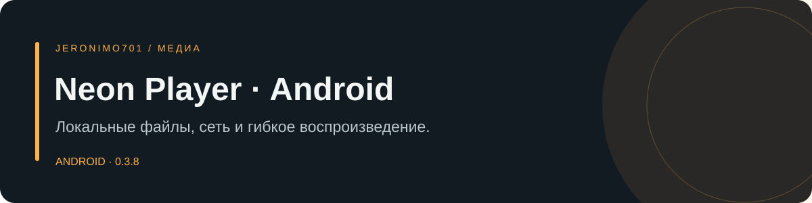

# Neon Player · Android

Полная версия Android-плеера на libmpv. В этом же репозитории сохранена финальная Neon Lite 0.6.0.

**[Скачать 0.3.8](https://github.com/jeronimo701/NeonPlayer-Android/releases/tag/v0.3.8) · [Последний релиз](https://github.com/jeronimo701/NeonPlayer-Android/releases/latest) · [Что изменилось](CHANGELOG.md) · [Все проекты](https://jeronimo701.github.io/)**

| Требования | Версия | Пакет |
|---|---|---|
| Android 9+ (см. ограничения) | 0.3.8 · debug APK | `app.neon.player` |

## Что умеет

**Файлы и сеть.** Локальные видео, SMB, FTP/SFTP, ссылки, плейлисты и внешний TorrServer.

**Управление просмотром.** Дорожки, субтитры, скорость, шейдеры и оформление Orange/Deck; режимы для телефона, широкого экрана и TV.

**Поиск JacRed.** Поддержаны Native и Jackett ответы: сиды/пиры, размер, даты и дополнительные поля.

**Lite остаётся доступной.** Отдельная лёгкая версия на системном MediaPlayer — 0.6.0. Её дальнейшее развитие завершено.

## Что нового

- Исправлено чтение количества сидов и пиров из Native API JacRed.
- Размеры больше 2 ГБ, даты, качество и другие доступные поля показываются корректно; неизвестные значения обозначаются «—», настоящий ноль остаётся нулём.
- Фильтрация и сортировка работают со всем полученным набором, а не только с видимыми строками. На экране показываются первые 500 из максимум 2000 полученных записей.
- Ссылки Кинопоиска и запросы по KP ID обрабатываются единообразно. Ошибка сервера не превращается в пустую выдачу.

## Установка

Выберите APK под архитектуру устройства. Для большинства современных телефонов подходит **arm64-v8a**; armeabi-v7a — для старых 32-битных устройств, x86_64 — для соответствующих ПК/эмуляторов. Разрешите установку APK из выбранного источника.

| Файл | Скачать |
|---|---|
| `Neon-Player-0.3.8-arm64-v8a.apk` | [APK](https://github.com/jeronimo701/NeonPlayer-Android/releases/download/v0.3.8/Neon-Player-0.3.8-arm64-v8a.apk) |
| `Neon-Player-0.3.8-armeabi-v7a.apk` | [APK](https://github.com/jeronimo701/NeonPlayer-Android/releases/download/v0.3.8/Neon-Player-0.3.8-armeabi-v7a.apk) |
| `Neon-Player-0.3.8-x86_64.apk` | [APK](https://github.com/jeronimo701/NeonPlayer-Android/releases/download/v0.3.8/Neon-Player-0.3.8-x86_64.apk) |

Сборки подписаны отладочным сертификатом. Для обновления поверх прежней установки подпись должна совпадать. Контрольные суммы — `SHA256SUMS.txt` в релизе.

## Full, Lite и NeonTorr

| Версия | Для чего |
|---|---|
| Full | libmpv, сетевые источники, шейдеры, внешний TorrServer |
| [Lite 0.6.0](https://github.com/jeronimo701/NeonPlayer-Android/releases/download/v0.3.7/Neon-Lite-0.6.0-universal.apk) | Лёгкая версия на системном MediaPlayer, Android 7.0+. Финальная, без дальнейших обновлений; исходники в lite/ |
| [NeonTorr](https://github.com/jeronimo701/NeonTorr) | Отдельное приложение со встроенным TorrServer |

[Neon Player для Windows](https://github.com/jeronimo701/mpv-neon).

## Ограничения и проверка

**Совместимость:** APK декларирует Android 8.0+, но lint и просмотр кода обнаружили обращение к API выреза экрана, доступному с Android 9, без проверки версии. Для этих предоставленных APK выбирайте Android 9+; Android 8/8.1 не заявляются проверенными. Также есть замечания RestrictedApi к обработке клавиш AndroidX. Бинарные файлы автора в этой публикации не исправлялись и не пересобирались.


Живая доступность JacRed зависит от сервера и сети. При разработке запрос из среды сборки возвращал HTTP 403; новые значения сидов в реальной выдаче этим релизом не подтверждаются. Проверки контракта описаны отдельно. Сервер TorrServer в этот APK не встроен.

Проверки этой публикации, подписи и совпадение APK с исходными сборками — [PUBLICATION-VALIDATION.md](PUBLICATION-VALIDATION.md). Подробности поведения и исторические проверки разработки — [docs/TECHNICAL.md](docs/TECHNICAL.md).

## Сборка

JDK 17 и Android SDK 35. Настройте `ANDROID_HOME` или локальный `sdk.dir`.

```powershell
python bootstrap.py
.\gradlew.bat :app:exportDebugApks :app:testDebugUnitTest
```

Соответствующие исходники native-зависимостей, ревизии и повторная сборка — [SOURCE-NOTES.md](SOURCE-NOTES.md). В релиз приложен архив исходников зависимостей; сами бинарные библиотеки в Git не помещаются.

## Лицензии

Собственный код: [GPL-3.0-or-later](LICENSE). Сторонние компоненты сохраняют свои условия: [THIRD-PARTY.md](THIRD-PARTY.md).
